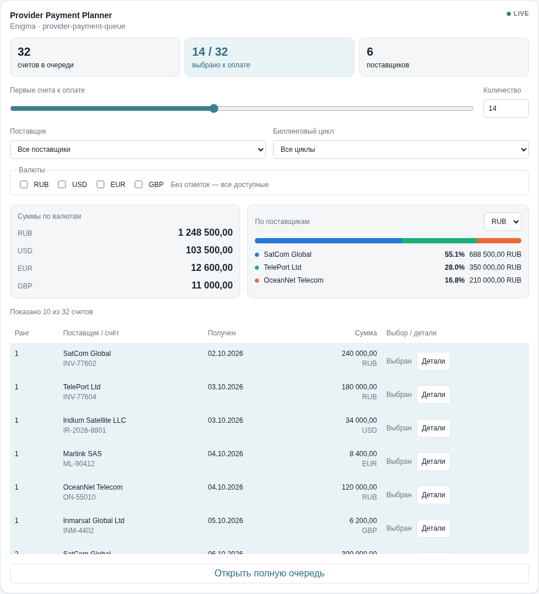
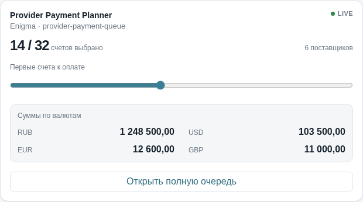
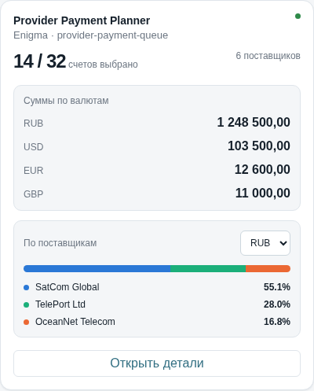
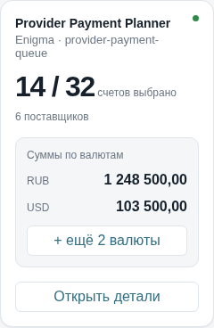

# INTERA Payment Planner

A read-only React widget for planning the first N supplier invoices in a payment queue. It provides currency totals, provider shares, invoice details, and four dashboard sizes in light and dark themes. The included sandbox runs entirely on the supplied local dataset; no backend or Enigma credentials are needed.

## Run locally

Recommended: **Node.js 24 LTS, version 24.15.0 or later within 24.x**, and npm. The tested version, **24.22.1**, is pinned in `.node-version` for reproducibility; that exact patch is not required. Clone the [GitHub repository](https://github.com/97Dmitry/test_mvc_telecom):

```sh
git clone https://github.com/97Dmitry/test_mvc_telecom.git
cd test_mvc_telecom
npm ci
npm run dev
```

You can also use GitHub's **Code → Download ZIP**, then run `npm ci` and `npm run dev` in the extracted project directory.

Open **http://127.0.0.1:5173**. If that port is occupied, use the URL printed by Vite. On WSL2, use the explicit IPv4 address above instead of `localhost`.

The sandbox toolbar switches size, theme, and source state; the parameter panel changes widget configuration. The interface retains the Russian labels of the supplied assignment.

To build and preview the production bundle:

```sh
npm run build
npx vite preview --host 127.0.0.1 --port 4173
```

The build is written to `dist/`. Preview is a local inspection server.

## Features and domain rules

- Provider, billing-cycle, and currency filters apply before selection. The queue is sorted by ascending `(payment_rank, provider_bill_id, originalIndex)`; invalid or missing ranks follow finite ranks.
- The first N filtered invoices are selected. Invalid provider amounts remain in the queue and consume a selection position, but are explicitly marked and excluded from totals and provider shares.
- Currency totals are separate. Provider shares are calculated within one currency, without conversion or a cross-currency grand total.
- The full view provides a slider, numeric input, local filters, totals, provider breakdown, and expandable invoice/customer-bill details. Every size can open the complete filtered queue in a dialog.
- Initial loading, background refresh, stale data, empty results, and errors have distinct presentations. Background refresh preserves the user's selection, filters, and expanded details.
- The quarter card initially shows up to two currencies and explicitly offers to reveal the remainder.

| Size parameter | Dashboard label | Presentation                                                                                   |
| -------------- | --------------- | ---------------------------------------------------------------------------------------------- |
| `full`         | XL              | Full controls, summaries, provider breakdown, and queue table                                  |
| `half`         | L               | Selection slider, currency totals, and queue action                                            |
| `third`        | M               | Selection count, currency totals, compact provider breakdown, and details action               |
| `quarter`      | S               | Selection count, compact currency totals with explicit overflow disclosure, and details action |

These names follow the supplied assignment. The sandbox demonstrates widths; final grid dimensions and card heights depend on the host layout.

## Screenshots

The delivery includes all four sizes in both themes in [docs/screenshots](./docs/screenshots). These light-theme examples link to the full-resolution PNGs:

| Full / XL                                                        | Half / L                                                             |
| ---------------------------------------------------------------- | -------------------------------------------------------------------- |
|    |        |
| Third / M                                                        | Quarter / S                                                          |
|  |  |

## Configuration

`parsePaymentPlannerParams(params)` accepts `Record<string, unknown> | undefined` and returns a normalized configuration. Numeric strings and string booleans are not coerced.

| Parameter               | Default                      | Accepted values and fallback                                                                                                    |
| ----------------------- | ---------------------------- | ------------------------------------------------------------------------------------------------------------------------------- |
| `description`           | `"Provider Payment Planner"` | Nonblank trimmed string; then trimmed `title`; then default                                                                     |
| `subtitle`              | `""`                         | Trimmed string; otherwise default                                                                                               |
| `size`                  | `"full"`                     | `"full"`, `"half"`, `"third"`, `"quarter"`; otherwise default                                                                   |
| `selectedCount`         | `10`                         | Finite number normalized with `Math.max(0, Math.round(n))`; otherwise default                                                   |
| `currencyIds`           | `[]`                         | Array of unique finite numbers; invalid members discarded; empty means all currencies                                           |
| `providerId`            | `"all"`                      | Any finite number or `"all"`; otherwise `"all"`                                                                                 |
| `billingCycleId`        | `"all"`                      | Any finite number or `"all"`; otherwise `"all"`                                                                                 |
| `amountFormat`          | `"grouped"`                  | `"grouped"` or `"plain"`; otherwise default                                                                                     |
| `rowLimit`              | `10`                         | `10`, `25`, `50`, `100`; legacy `maxRows` is read only when `rowLimit` is absent; an explicitly invalid `rowLimit` uses default |
| `showCustomerBills`     | `true`                       | Boolean; otherwise default                                                                                                      |
| `showProviderBreakdown` | `true`                       | Boolean; otherwise default                                                                                                      |
| `showSummary`           | `true`                       | Boolean; otherwise default                                                                                                      |

The component's optional `size` prop overrides `params.size`. Local filters further narrow the configured scope; resetting local filters does not remove external restrictions. `rowLimit` limits the inline table only, not selection, calculations, or the complete-queue dialog. Changing a configured selection/filter resets its corresponding local override; ordinary source refreshes preserve it.

`grouped` uses Russian thousands/decimal separators; `plain` uses ungrouped decimal-point notation. Both display two decimal places with the same `Intl.NumberFormat` rounding.

## Component usage

The source contract is `ICollectionDataResult<IProviderPaymentQueueRow>` in [widget-types.ts](./src/platform/widget-types.ts); invoice fields are defined in [provider-payment-queue.ts](./src/types/provider-payment-queue.ts). Supply the entire envelope on each update:

```tsx
import { PaymentPlannerWidget } from "./src/widget/payment-planner";
import type { ICollectionDataResult } from "./src/platform/widget-types";
import type { IProviderPaymentQueueRow } from "./src/types/provider-payment-queue";
import "./src/platform/theme.css";

export function PaymentDashboard({ rows }: { rows: readonly IProviderPaymentQueueRow[] }) {
  const data: ICollectionDataResult<IProviderPaymentQueueRow> = {
    items: rows,
    loading: false,
    loaded: true,
    error: null,
    stale: false,
    lastSuccessAt: new Date().toISOString(),
  };

  return (
    <PaymentPlannerWidget
      data={data}
      size="full"
      params={{ description: "Supplier payments", selectedCount: 10, rowLimit: 25 }}
    />
  );
}
```

Set `data-theme="light"` or `data-theme="dark"` on the document's `<html>` element. The widget imports its own stylesheet and uses the supplied platform components and theme tokens. The host owns source loading and errors; this component does not fetch or mutate invoices. For refresh, keep `loaded: true` and pass the last successful `items` while `loading: true`.

## Architecture and libraries

| Location                                 | Responsibility                                                                             |
| ---------------------------------------- | ------------------------------------------------------------------------------------------ |
| `src/widget/payment-planner-params.ts`   | Defensive configuration parsing and defaults                                               |
| `src/widget/payment-planner-compute.ts`  | Pure filtering, stable sorting, selection, and aggregation; no React/DOM or input mutation |
| `src/widget/payment-planner.tsx`, `.css` | UI, local interaction state, responsive presentation, and complete-queue dialog            |
| `src/platform/`                          | Supplied INTERA components, types, formatting helpers, and theme tokens                    |
| `src/sandbox/`                           | Interactive demonstration of configuration, sizes, themes, and source states               |
| `src/data/mock-payment-queue.json`       | Supplied fixture, preserved unchanged                                                      |
| `tests/e2e/`                             | Chromium interaction and layout regression coverage                                        |

React 19 and React DOM render the interface; TypeScript 5 checks types; Vite builds and serves the sandbox. Vitest, Testing Library, and jsdom cover calculations and component interactions; Playwright exercises Chromium. Oxlint checks code correctness and Oxfmt formats the source. Dependency versions are resolved in `package-lock.json`.

## Verification and delivery

```sh
npm run lint
npm run format:check
npm run typecheck
npm test
npm run build
npx playwright install chromium
npm run test:e2e
```

The verified baseline is **132 unit/component tests** and **21 Chromium E2E tests**. See [development.md](./docs/development.md) for browser setup, covered edge cases, and operational details, and [acceptance.md](./docs/acceptance.md) for the delivery checklist.

To regenerate the delivery screenshots (after installing Chromium):

```sh
node scripts/capture-screenshots.mjs
```

The capture script starts its own Vite server on port 4175 and stops it afterwards. The same `PLAYWRIGHT_CHROMIUM_EXECUTABLE_PATH` override described in the development guide is supported.

Delivery is through the [GitHub repository](https://github.com/97Dmitry/test_mvc_telecom), including this README, [screenshots](https://github.com/97Dmitry/test_mvc_telecom/tree/main/docs/screenshots), [development guide](https://github.com/97Dmitry/test_mvc_telecom/blob/main/docs/development.md), and [acceptance checklist](https://github.com/97Dmitry/test_mvc_telecom/blob/main/docs/acceptance.md). The source and review materials are available through these repository links.

## Scope and limitations

The original requirement is [INTERA-Task-2](https://github.com/MVS-Telecom/INTERA-Task-2), preserved in [task-original.md](./docs/reference/task-original.md), with the unchanged [reference layout](./reference-layout.svg). The fixture contains **32 records**, despite the original text referring to 30; the data is retained in full.

This is an analytical, read-only implementation with a local demonstration source. Real payments, a backend, and an Enigma connection are outside its scope. JavaScript `number` arithmetic is suitable for this task's analytics and rounds only for display; it is not an accounting decimal engine. Chromium was verified in WSL2/Arch; Firefox, Safari, and the real INTERA host runtime have not been verified.
